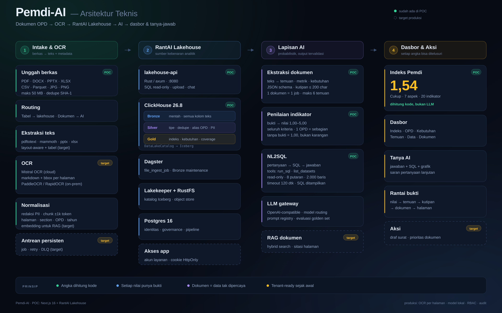
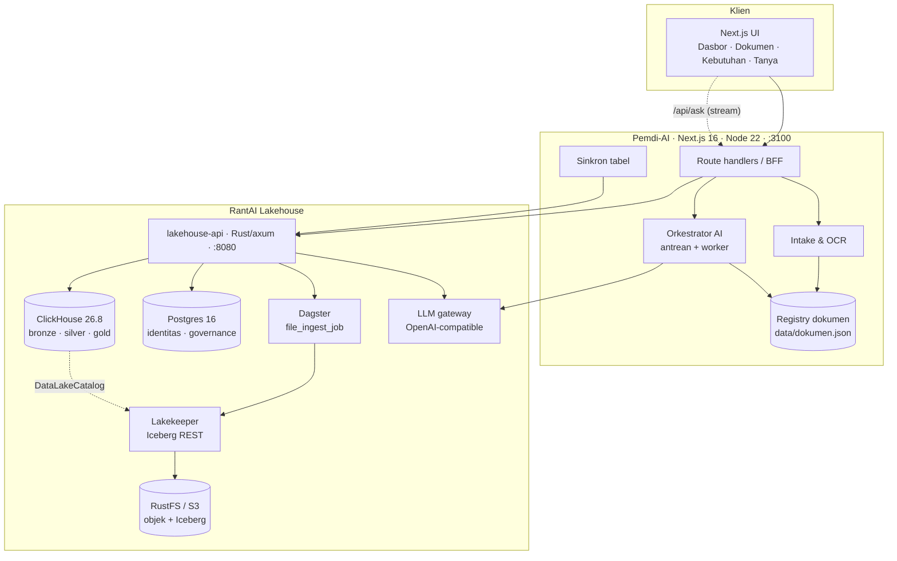
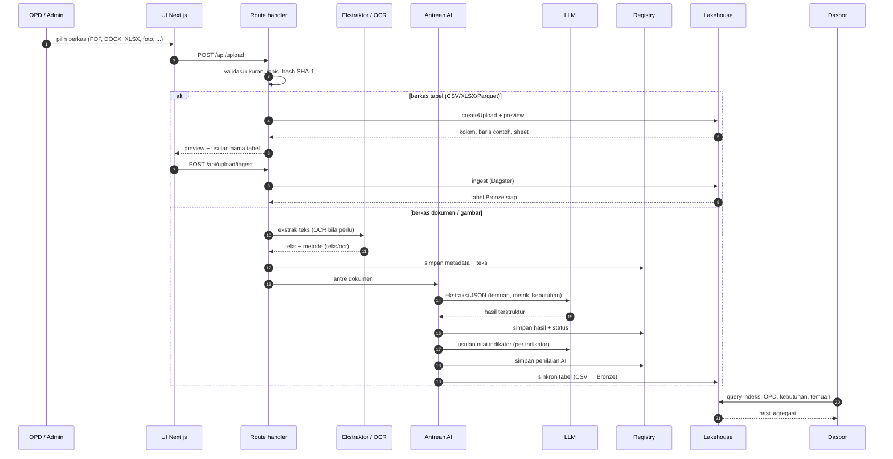
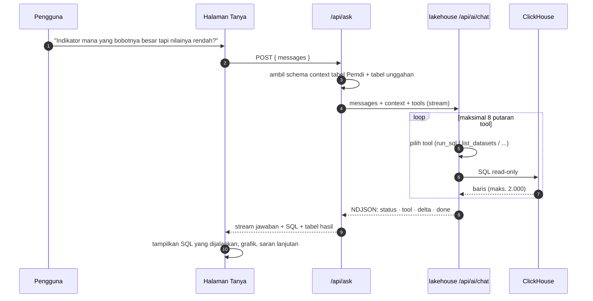
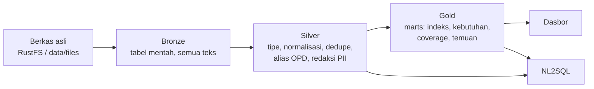

# Arsitektur Teknis Pemdi-AI

Dokumen ini menjelaskan arsitektur Pemdi-AI dari **berkas masuk** sampai **AI
menjawab**, termasuk penyimpanan, pemrosesan dokumen, OCR, penilaian indeks,
dan NL2SQL. Sasaran pembaca: tim engineering, tim data, dan pengambil keputusan
yang perlu tahu bagian mana yang sudah jalan di POC dan bagian mana yang masih
rancangan produksi.



*Gambar 1 — Arsitektur end-to-end: intake & OCR → RantAI Lakehouse → lapisan AI → dasbor. Versi SVG ada di [`arsitektur.svg`](arsitektur.svg); diagram Mermaid yang bisa diedit ada di bagian 3.*

Legenda status:

| Tanda | Arti |
| --- | --- |
| ✅ | Sudah berjalan di POC (repo ini) |
| 🔜 | Target produksi, belum dibangun |
| 🧪 | Ada, tetapi masih terbatas / perlu diperkuat |

---

## 1. Ringkasan

Pemdi-AI adalah aplikasi evaluasi kinerja pemerintah digital untuk
kabupaten/kota. Alurnya:

> **dokumen apa pun → AI membaca → data terstruktur → dasbor + tanya-jawab**

Empat lapisan utamanya:

1. **Intake** — menerima PDF, Word, PowerPoint, Excel/CSV/Parquet, dan foto;
   mengekstrak teks; OCR untuk hasil pindai; menyimpan berkas asli dan teks.
2. **Lakehouse** — RantAI Lakehouse menyimpan tabel mentah (Bronze) di
   ClickHouse/Iceberg, menyediakan SQL, katalog, dan orkestrasi Dagster.
3. **AI** — tiga pekerjaan berbeda: ekstraksi temuan dokumen, usulan nilai
   indikator, dan tanya-jawab NL2SQL atas data.
4. **Penyajian** — dasbor Indeks Pemdi (7 aspek, 20 indikator), kesiapan OPD,
   status kebutuhan data, dan halaman Tanya.

Prinsip yang mengikat seluruh desain:

- **Angka resmi dihitung kode, bukan LLM.** LLM membaca dan mengusulkan; rumus
  indeks dijalankan deterministik di TypeScript.
- **Setiap nilai punya rantai bukti.** Nilai → penilaian → temuan → kutipan →
  dokumen → halaman. Tanpa bukti, indikator tidak dikarang: nilainya jatuh ke
  batas bawah dan alasannya ditulis.
- **Bronze mentah dan tidak berubah; Silver/Gold bisa dibangun ulang.**
- **Dokumen adalah data yang tidak dipercaya.** Isi dokumen tidak boleh menjadi
  instruksi bagi model (prompt injection).
- **Satu tenant = satu kabupaten/kota.** POC satu tenant (TBB), tetapi ID
  tenant disiapkan sejak awal agar bisa menjadi layanan multi-daerah.

---

## 2. Konteks dan batasan

| Hal | Nilai |
| --- | --- |
| Dasar hukum | Permen PANRB No. 8 Tahun 2026 tentang Evaluasi Kinerja Pemerintah Digital |
| Kerangka nilai | 7 aspek, 20 indikator, bobot total 1,00; tiap indikator bernilai 1,00–5,00 |
| Predikat | Kurang, Cukup, Baik, Sangat Baik, Memuaskan (Tabel 4 Permen) |
| Data POC | Kabupaten Tulang Bawang Barat: survei OPD, dokumen pendukung, inventaris aplikasi, data statistik, BPS "TBB Dalam Angka 2024" |
| Katalog kebutuhan data | 68 item (tafsir Pemdi-AI atas kriteria Permen), tersebar di 20 indikator |
| Batas unggah | 50 MB per berkas |
| Model bahasa | Endpoint OpenAI-compatible (`LLM_URL`, `LLM_MODEL`, `LLM_KEY`); model bisa diganti tanpa mengubah kode — POC saat ini memakai `deepseek-v4.1-flash` |
| Lakehouse | RantAI Lakehouse: Rust/axum, ClickHouse 26.8, Postgres 16, Dagster, Lakekeeper, RustFS |

Yang **bukan** tujuan POC: penilaian resmi menggantikan asesor, multi-tenant
produksi, SLA, dan pelatihan model sendiri.

---

## 3. Diagram sistem



Pembagian tanggung jawab:

| Komponen | Tanggung jawab | Status |
| --- | --- | --- |
| Next.js app | UI, sesi pengguna, unggah, orkestrasi pipeline, BFF ke lakehouse | ✅ |
| Intake | Deteksi jenis berkas, ekstraksi teks, OCR, simpan asli + teks | ✅ |
| Registry | Status tiap dokumen dan hasil AI-nya | 🧪 JSON file, perlu pindah ke Postgres |
| Lakehouse API | SQL read-only, unggah tabel, katalog, sesi, NL2SQL | ✅ |
| ClickHouse | Tabel Bronze, agregasi dasbor, sumber NL2SQL | ✅ |
| Dagster | Menjalankan `file_ingest_job` untuk memuat unggahan ke Bronze | ✅ |
| Lakekeeper + RustFS | Katalog Iceberg dan object store | ✅ |
| LLM gateway | Ekstraksi, penilaian, NL2SQL | ✅ |
| OCR | RapidOCR lokal (POC) → OCR layout-aware per halaman (Mistral di cloud, PaddleOCR/RapidOCR di on-prem) | 🧪 / 🔜 |

---

## 4. Alur end-to-end

### 4.1 Unggah dokumen sampai dasbor



### 4.2 Tanya data (NL2SQL)



---

## 5. Lapisan 1 — Sumber dan intake

### 5.1 Jenis berkas dan routing

| Kelas | Ekstensi | Perlakuan |
| --- | --- | --- |
| Tabel | `csv`, `tsv`, `xls`, `xlsx`, `parquet` | Masuk lakehouse sebagai tabel Bronze; tidak dibaca LLM per sel |
| Dokumen | `pdf`, `docx`, `pptx`, `txt`, `md` | Ekstraksi teks → registry → antrean AI |
| Gambar | `jpg`, `jpeg`, `png` | OCR → teks → registry → antrean AI |
| Lain | selain di atas | Ditolak (415) |

Berkas > 50 MB ditolak (413). Nama tabel dinormalisasi menjadi
`^[a-z][a-z0-9_]*$`, dan nama yang bentrok dengan tabel milik Pemdi-AI ditolak
(409).

### 5.2 Jalur tabel

1. Berkas disimpan di object store lakehouse lewat `POST /api/uploads`.
2. `preview` membaca encoding, delimiter, baris header, dan sheet.
3. Pengguna memilih sheet/nama tabel; `POST /api/uploads/:id/ingest` memicu
   Dagster `file_ingest_job`.
4. Dagster menulis Iceberg Bronze lewat Lakekeeper; ClickHouse membaca tabel
   itu lewat `DataLakeCatalog` dengan nama ``icecat_api.`bronze.<tabel>` ``.
5. Semua kolom masuk sebagai teks; cast dilakukan saat query
   (`toFloat64OrNull`, `toInt32OrNull`).

Alasan semua kolom teks: berkas dari OPD sangat tidak seragam (angka dengan
koma, spasi, satuan menempel). Menebak tipe saat ingest akan membuang data;
pembersihan dilakukan di Silver, bukan di pintu masuk.

### 5.3 Jalur dokumen

POC saat ini:

| Format | Cara ekstraksi |
| --- | --- |
| PDF bertext-layer | `pdftotext -q -enc UTF-8` |
| PDF pindaian / foto | render `pdftoppm` 110 DPI, halaman 1–6 → RapidOCR (ONNX) |
| DOCX | `mammoth.extractRawText` |
| PPTX | `unzip` XML slide, buang tag |
| XLSX | `xlsx` → CSV per sheet |
| TXT/MD/CSV | decode UTF-8 |

Keterbatasan yang harus disadari:

- OCR hanya **6 halaman pertama** dan berjalan **sinkron di request unggah**
  (timeout 300 detik). Dokumen 40 halaman tidak terbaca penuh.
- OCR sering menghilangkan spasi antarkata; pencocokan kata kunci memakai regex
  longgar, tetapi kualitas teks tetap lebih rendah dari OCR modern.
- Tidak ada penanda halaman/section; kutipan temuan tidak bisa ditunjuk ke
  halaman asal.
- Teks dipotong **14.000 karakter** sebelum dikirim ke LLM.
- Tidak ada deteksi bahasa, redaksi PII, atau deteksi tabel pada PDF.

### 5.4 OCR produksi: dua profil deployment

Dokumen ini membedakan dua profil, karena syarat privasi tiap pemda berbeda:

| Aspek | Cloud / POC | On-premise (program SKALA+) |
| --- | --- | --- |
| OCR | Mistral OCR | RapidOCR/PaddleOCR lokal; Mistral hanya opsional untuk dokumen non-sensitif dengan DPA |
| LLM | gateway OpenAI-compatible eksternal | model lokal (vLLM/Ollama/llama.cpp) di server GPU/NPU |
| Data | teks dokumen keluar ke penyedia | dokumen dan teks tetap di lingkungan pemda |
| Biaya | per halaman / per token | listrik + perangkat; tidak ada biaya per panggilan |

Profil cloud dipakai untuk POC dan dokumen yang memang boleh keluar. Untuk
program yang menjanjikan pemrosesan on-premise, **profil on-premise adalah
default**; Mistral OCR tidak boleh disebut sebagai jalur utama.

Pada profil cloud, OCR diganti menjadi layanan OCR layout-aware, dengan
**Mistral OCR (`mistral-ocr-latest`)** sebagai jalur utama profil tersebut. Alasannya:

- mengembalikan **Markdown per halaman** plus blok dan kotak pembatas
  (bbox), sehingga kutipan bisa ditautkan ke halaman;
- jauh lebih baik untuk **tabel**, header multi-baris, dan dokumen campuran
  gambar–teks dibanding OCR klasik;
- mendukung bahasa Indonesia dan dokumen pindaian miring/kualitas rendah;
- tidak perlu merawat render PDF → gambar → OCR sendiri.

Rancangan alurnya:

```text
PDF/gambar
  → cek text layer (PyMuPDF)
      ├─ ada teks memadai  → ekstraksi layout lokal (tanpa OCR)
      └─ tidak ada teks    → Mistral OCR
                             ├─ sukses → markdown + bbox + confidence per halaman
                             └─ gagal  → fallback RapidOCR/PaddleOCR lokal
  → normalisasi → redaksi PII → chunk + metadata halaman
```

Catatan operasional:

- Kirim per **batch halaman**, bukan satu PDF raksasa; simpan hasil per halaman
  dengan hash gambar agar OCR tidak diulang saat dokumen diunggah ulang.
- Simpan `ocr_provider`, `ocr_version`, `ocr_confidence`, dan `page_count`
  supaya hasil bisa direproduksi.
- Untuk instansi dengan syarat data tidak keluar negeri, sediakan mode
  **on-prem** (RapidOCR/PaddleOCR + model lokal); pilihan ini per tenant.
- OCR hanya dijalankan bila text layer kosong/terlalu pendek — menghemat biaya
  dan waktu.
- Batas biaya: hitung per halaman; antrean OCR dipisah dari antrean LLM agar
  dokumen besar tidak memblokir dokumen kecil.

### 5.5 Normalisasi, PII, dan chunking

🔜 Target:

1. **Normalisasi** — NFKC, buang karakter kontrol, rapikan spasi, pertahankan
   struktur heading/tabel. Jangan menurunkan teks ke satu baris.
2. **Deteksi bahasa** — Indonesia sebagai default; istilah asing dipertahankan.
3. **Redaksi PII** — NIK, NPWP, nomor telepon, email, nama responden. POC sudah
   tidak memuat nama/email/telepon responden survei; produksi harus meredaksi
   juga di teks dokumen sebelum dikirim ke LLM.
4. **Chunking** — 800–1.200 token, overlap 10–15%, tidak memotong tabel;
   metadata: `dokumen_id`, `halaman`, `section`, `opd`, `tahun`, `jenis`.
5. **Embedding (opsional)** — untuk pertanyaan yang jawabannya ada di narasi
   dokumen, bukan di tabel. Simpan di pgvector (skala POC) atau Qdrant
   (jika > 1 juta chunk).

### 5.6 Intake data berbantuan AI

Berkas tabel tidak selalu rapi: header di baris ke-3, angka memakai koma,
nama kolom singkat, ada kolom PII, dan satu berkas bisa berisi beberapa tabel.
🔜 Sebelum dimuat, AI membantu **membaca calon skema**, bukan mengubah data:

- profil kolom: tipe yang paling mungkin, null %, nilai unik, rentang, contoh;
- deteksi PII (NIK, NPWP, telepon, email, nama) → tandai untuk redaksi;
- usulan arti kolom dan **pemetaan** ke tabel Pemdi yang ada
  (`pemdi_opd`, `pemdi_survei`, `tbb_dalam_angka`, ...);
- usulan kunci join dan granularitas (satu baris = satu OPD per tahun?);
- peringatan kualitas: duplikat, nilai di luar rentang 1–5, bobot tidak 1,00,
  OPD tidak dikenal;
- usulan nama tabel yang aman.

Pengguna tetap mengonfirmasi sheet, header, dan nama tabel sebelum ingest.
AI hanya memberi usulan; tidak ada penulisan otomatis ke lakehouse. Profil dan
keputusan disimpan di `pemdi_dokumen`/`pemdi_audit` agar asal-usul tabel jelas.

### 5.7 Status dan antrean

Status yang harus terlihat oleh pengguna:

```text
diunggah → teks_dibaca / ocr → menunggu_ai → dianalisis → dinilai → tersinkron
                                                   └→ gagal (dengan alasan)
```

POC: antrean di memori, paralel 3 dokumen, berhenti jika server restart.
🔜 Produksi: antrean persisten (Postgres `job_queue` atau NATS/Redis), kunci
idempoten `dokumen_id + versi_prompt`, retry dengan backoff, dead-letter queue,
dan progres per tahap.

---

## 6. Lapisan 2 — Lakehouse dan model data

### 6.1 Komponen RantAI Lakehouse

| Komponen | Peran |
| --- | --- |
| `lakehouse-api` (Rust/axum) | API SQL, unggahan, katalog, sesi, AI copilot |
| ClickHouse 26.8 | Analitik: tabel Bronze, agregasi dasbor, sumber NL2SQL |
| Postgres 16 | Identitas, governance, metadata pipeline, sesi |
| Dagster | Orkestrasi ingest berkas dan pemeliharaan Bronze |
| Lakekeeper | Katalog Iceberg (REST) |
| RustFS | Object store kompatibel S3 untuk berkas dan data Iceberg |
| LLM gateway | Endpoint OpenAI-compatible untuk copilot dan app |

Aplikasi **tidak** membuka koneksi langsung ke ClickHouse. Semua lewat
`lakehouse-api`, dengan akun layanan (`LAKEHOUSE_EMAIL`/`LAKEHOUSE_PASSWORD`)
dan header tenant. Sesi lakehouse adalah cookie HttpOnly; browser tidak pernah
memegangnya.

### 6.2 Medallion



- **Bronze** — apa adanya dari sumber: satu baris per dokumen/temuan/metrik/
  jawaban survei. Tidak ada logika bisnis.
- **Silver** — tipe data benar, nama OPD diseragamkan (mis. "Diskominfo" →
  "Dinas Komunikasi, Informatika, Persandian dan Statistik"), duplikat dibuang,
  temuan divalidasi, PII diredaksi.
- **Gold** — tabel siap pakai: indeks per aspek/OPD, status kebutuhan, tren
  bulanan, perbandingan antar-daerah (untuk multi-tenant).

POC baru punya Bronze + agregasi di aplikasi. 🔜 Silver/Gold dibangun dengan
Dagster assets + dbt, dengan tes kualitas data (not null, rentang 1–5, bobot
total 1,00, jumlah indikator 20).

### 6.3 Tabel yang ada

Semua tabel berada di ``icecat_api.`bronze.<nama>` ``.

| Tabel | Isi |
| --- | --- |
| `pemdi_indikator` | 20 indikator, aspek, bobot, deskripsi |
| `pemdi_kriteria` | Kriteria tiap tingkat 1–5 per indikator |
| `pemdi_penilaian` | Nilai per indikator (AI/Manual), penjelasan, waktu |
| `pemdi_opd` | Profil OPD, status pengisian survei, jumlah dokumen |
| `pemdi_survei` | Satu baris per pertanyaan per OPD + jawaban |
| `pemdi_dokumen` | Registry dokumen: OPD, jenis, ukuran, metode teks, status AI |
| `pemdi_temuan` | Temuan per indikator + tingkat + kutipan |
| `pemdi_metrik` | Angka yang dilaporkan dokumen (IKM, jumlah layanan, ...) |
| `pemdi_kebutuhan` | Status 68 kebutuhan data + OPD yang belum menyerahkan |
| `pemdi_aplikasi` | Inventaris subdomain/aplikasi |
| `pemdi_data_statistik` | Katalog data statistik sektoral + status |
| `tbb_dalam_angka` | BPS TBB Dalam Angka 2024 (bentuk panjang) |

Tabel tambahan yang dibutuhkan produksi:

| Tabel | Isi |
| --- | --- |
| `pemdi_tenant` | Kabupaten/kota, konfigurasi, kuota, status |
| `pemdi_pengguna` | Akun, peran, OPD, tenant (pindah dari `users.json`) |
| `pemdi_dokumen_teks` | Teks per halaman/section + URI objek asli |
| `pemdi_chunk` | Potongan teks + embedding + metadata halaman |
| `pemdi_job` | Antrean persisten, status, retry, error |
| `pemdi_audit` | Siapa mengunggah/menilai/bertanya, SQL, model, versi prompt |
| `pemdi_evaluasi` | Golden set dan hasil evaluasi kualitas AI |

### 6.4 Cara menulis ke lakehouse

POC: aplikasi menyusun CSV di memori, memanggil `createUpload` → `preview` →
`ingest` → polling `getUpload` sampai `ingested` (maks. 300 detik), lalu
**mengganti seluruh tabel**. Sinkronisasi berjalan serial di latar belakang;
permintaan baru saat sinkron berjalan memicu satu putaran tambahan.

Keterbatasan:

- Load penuh (bukan incremental), jadi tabel besar makin lambat.
- Query dibatasi 2.000 baris; agregasi harus dilakukan di SQL, bukan di app.
- Tidak ada transaksi lintas tabel: pembaca bisa melihat setengah pembaruan.
- Jika lakehouse mati, pembacaan mengembalikan hasil kosong (degradasi anggun),
  tetapi penulisan tertunda.

🔜 Produksi:

- Dagster asset per tabel dengan **merge/upsert** berdasarkan kunci alami.
- Partisi `tenant_id`, `tahun`, dan `bulan` untuk tabel besar.
- Data contract + quality check sebelum publish ke Gold.
- Tulis Silver/Gold lewat dbt; aplikasi tidak lagi menyusun CSV.
- Outbox pattern: perubahan registry → event → worker → lakehouse, dengan
  idempotensi.

---

## 7. Lapisan 3 — AI

Ada **tiga pekerjaan AI yang berbeda** dan tidak boleh dicampur:

| Pekerjaan | Masukan | Keluaran | Sifat |
| --- | --- | --- | --- |
| Ekstraksi dokumen | Teks satu dokumen | Temuan, metrik, kebutuhan | Probabilistik, per dokumen |
| Penilaian indikator | Bukti agregat satu indikator | Usulan nilai 1,00–5,00 + alasan | Probabilistik, per indikator |
| NL2SQL | Pertanyaan + skema | SQL + jawaban + baris | Probabilistik, read-only |

### 7.1 Ekstraksi dokumen

Prompt memuat 20 nama indikator dan 68 item kebutuhan, lalu meminta satu objek
JSON:

```json
{
  "jenis_dokumen": "SOP|Laporan SKM|Peraturan|SK|Katalog layanan|Daftar aplikasi|Data|Laporan|Lainnya",
  "judul": "...",
  "tahun": "YYYY",
  "ringkasan": "1-2 kalimat",
  "temuan": [
    {
      "indikator": 20,
      "pernyataan": "kondisi saat ini yang relevan",
      "tingkat": 1,
      "kutipan": "potongan <= 200 karakter"
    }
  ],
  "metrik": [
    { "nama": "nilai IKM", "nilai": "82.5", "satuan": "indeks", "periode": "2025", "indikator": 20 }
  ],
  "kebutuhan": ["20.1", "19.2"]
}
```

Aturan prompt:

- hanya memakai isi dokumen; dilarang menambah fakta/angka/nama;
- `tingkat` adalah tingkat yang didukung temuan itu **sendiri** (1 = rencana,
  2 = sebagian, 3 = menyeluruh/terstandar, 4 = direviu berkala, 5 = tindak
  lanjut reviu);
- maksimal 6 temuan dan 8 metrik — lebih baik sedikit dan kuat;
- `kebutuhan` hanya diisi jika dokumen **benar-benar** memenuhi item, bukan
  sekadar menyebutnya;
- teks OCR dibaca toleran (kata menempel, salah eja).

Setelah model menjawab, hasil **dibersihkan dan divalidasi** di kode: indikator
harus 1–20, tingkat 1–5, kutipan dipotong, id kebutuhan harus ada di katalog,
array dipotong sesuai batas. Model tidak boleh menentukan skema.

Kegagalan:

- JSON tidak terbaca / terpotong → satu retry dengan token 2×;
- `finish_reason = length` → dianggap gagal, bukan dipakai sebagian;
- reasoning `...` dibuang sebelum parsing;
- dokumen < 80 karakter teks → gagal dengan alasan "tidak ada teks".

🔜 Produksi:

- **Map-reduce per section/halaman** untuk dokumen panjang, bukan potong 14.000
  karakter. Tiap chunk menghasilkan temuan dengan `halaman` dan `section`.
- **Verifikasi kutipan**: cocokkan kutipan ke teks sumber (normalisasi
  spasi/tanda baca). Kutipan yang tidak ditemukan ditandai `confidence: low`.
- **Deduplikasi temuan** lintas chunk dan lintas dokumen.
- **Deteksi kontradiksi** antar-dokumen (mis. dua OPD melaporkan angka IKM
  berbeda) → masuk antrean review manusia.
- **Klasifikasi dokumen** yang lebih kaya dan confidence per field.
- **Human-in-the-loop**: temuan `low confidence` tidak otomatis dipakai untuk
  penilaian.

### 7.2 Penilaian indikator

Untuk tiap indikator, sistem menyusun **evidence pack**:

1. status dokumen kunci (terpenuhi / sebagian / perlu dicek / belum ada);
2. temuan dari semua dokumen (maks. 60) + OPD + kutipan;
3. metrik yang dilaporkan (maks. 40);
4. jawaban survei OPD yang relevan (maks. 40);
5. kriteria tingkat 1–5 dari Permen.

Aturan penilaian:

- pilih **tingkat tertinggi yang seluruh kriterianya didukung bukti**;
- rencana/"to-be" bukan pemenuhan kriteria;
- praktik di satu-dua OPD = "sebagian", bukan "seluruh";
- dokumen kunci yang **belum ada** berarti kriteria yang bergantung padanya
  tidak terpenuhi;
- tanpa bukti → nilai 1,00 dan alasannya ditulis, bukan dikarang;
- nilai harus berada dalam rentang tingkatnya (1 = 1,00–1,49; 2 = 1,50–2,49;
  3 = 2,50–3,49; 4 = 3,50–3,99; 5 = 4,00–5,00).

Keluaran:

```json
{
  "tingkat": 3,
  "nilai": 2.75,
  "penjelasan": "kriteria mana yang terpenuhi dan bukti dari OPD mana",
  "kekurangan": ["bukti yang belum ada untuk naik ke tingkat berikutnya"]
}
```

Penilaian **manual tidak pernah ditimpa** AI. Penilaian AI diberi label
`penilai = "AI"`; manual `penilai = "Manual"`. Halaman Penilaian menampilkan
usulan AI, lalu pengguna menerima atau mengubahnya.

### 7.3 Indeks dihitung kode

Rumus (Permen):

```text
indeks_aspek(a) = Σ(bobot_indikator(i) × nilai(i)) / bobot_aspek(a)   untuk i ∈ a
indeks_pemdi    = Σ(bobot_aspek(a) × indeks_aspek(a))               untuk semua a
```

Aturan implementasi:

- aspek hanya dihitung jika **semua** indikatornya punya nilai;
- indeks hanya dihitung jika **semua** aspek terisi;
- selama belum lengkap, tampilkan `sementara` (rata-rata terbobot dari
  indikator yang sudah terisi) dan jumlah indikator terisi;
- pembulatan hanya di lapisan tampilan, bukan di data;
- LLM tidak pernah menghitung indeks.

Alasannya: hasil harus bisa direproduksi dan diaudit. Model bahasa boleh salah
membaca; aritmetika tidak boleh ikut salah.

### 7.4 NL2SQL

Alur:

```text
pertanyaan pengguna
  → /api/ask (Next.js)
  → schema context: 12 tabel Pemdi + tabel unggahan (maks. 5.900 karakter)
  → lakehouse /api/ai/chat (agentic loop, maks. 8 putaran)
  → tools: run_sql, list_datasets, describe_dataset, lakehouse_overview
  → jawaban + SQL terakhir + baris + jumlah kueri
```

Kontrak ketat:

- **Read-only.** Hanya `SELECT`; `run_sql` melakukan dry-run `EXPLAIN AST`
  untuk menolak DDL/DML dan tabel sistem.
- **Dibatasi.** Maksimal 2.000 baris per kueri; timeout 120 detik di lakehouse,
  300 detik di route app.
- **Streaming.** Lakehouse mengirim NDJSON (`status`, `tool`, `delta`, `done`);
  app meneruskan sebagai NDJSON dan mengirim `ping` tiap 15 detik agar
  Cloudflare tidak memutus koneksi.
- **SQL selalu ditampilkan.** Pengguna bisa membuka kueri di balik jawaban.
- **Bahasa jawaban** Indonesia; instruksi melarang aksara CJK.
- **Riwayat** dibatasi 12 pesan terakhir agar konteks tidak meledak.
- **Tanpa jawaban** → tampilkan error yang jelas, bukan halaman kosong.

Yang membuat jawaban bagus:

- **Schema context yang menerangkan arti kolom**, bukan hanya nama kolom.
  Contoh: `bobot_indikator` adalah pecahan (0,15 = 15%); semua kolom teks
  sehingga perlu `toFloat64OrNull`.
- **Semantic layer** 🔜: glosarium OPD (nama pendek vs resmi), definisi
  indikator/aspek, definisi metrik, cara memilih periode, contoh
  pertanyaan→SQL, dan petunjuk join.
- **Golden set** 🔜: pertanyaan demo (what-if kenaikan indikator, indikator
  bobot besar/nilai rendah, dokumen yang mendongkrak beberapa indikator,
  kecamatan dengan pertumbuhan penduduk tercepat, draf surat) dieksekusi ulang
  di CI untuk mengukur *execution accuracy* dan regresi.
- **Cache** 🔜: cache hasil untuk pertanyaan identik dalam TTL pendek; invalidasi
  saat sinkron tabel selesai.
- **Pemisahan tugas** 🔜: pertanyaan tentang **isi dokumen** ("apa bunyi SOP
  Dispora?") tidak dijawab SQL, tetapi lewat RAG chunk dokumen. Router memilih
  SQL, RAG, atau keduanya.

### 7.5 RAG dokumen (target)

NL2SQL hanya menjawab data terstruktur. Pertanyaan seperti "dokumen mana yang
menyebut IKM 82,5?" atau "ringkas SOP Dinas Pertanian" membutuhkan retrieval.

Rancangan:

- chunk dokumen + embedding (multilingual, mis. `bge-m3` / `multilingual-e5`);
- hybrid search: BM25 + vektor, filter `tenant_id`, `opd`, `indikator`,
  `tahun`;
- rerank 20 → 5 chunk;
- jawaban wajib menyertakan `dokumen_id`, halaman, dan kutipan;
- jika tidak ada chunk yang cukup relevan, jawab "tidak ditemukan" — jangan
  mengarang.

### 7.6 Model routing dan prompt registry

| Tugas | Model | Alasan |
| --- | --- | --- |
| Ekstraksi dokumen | Model kuat, konteks panjang, temperature rendah | Akurasi struktur dan kutipan |
| Penilaian indikator | Model reasoning kuat | Membandingkan kriteria dan bukti |
| NL2SQL | Model dengan tool-calling andal | Loop tool, SQL dialect ClickHouse |
| Saran pertanyaan | Model murah/cepat | Hanya 3 pertanyaan pendek |

Semua lewat gateway OpenAI-compatible agar vendor bisa diganti tanpa mengubah
app. Yang harus disimpan per hasil: `model`, `prompt_version`, `temperature`,
`token_in`, `token_out`, `latency_ms`, `status`.

Profil on-premise memakai model lokal di server pemda. POC saat ini masih
memakai endpoint eksternal; klaim "dokumen tidak keluar" hanya boleh dipakai
setelah `LLM_URL` benar-benar diarahkan ke model lokal dan endpoint eksternal
dimatikan.

🔜 Prompt disimpan sebagai file berversi (`prompts/ekstraksi/v3.md`) dan
di-deploy bersama app; perubahan prompt melewati eval, bukan edit langsung di
produksi.

### 7.7 Evaluasi kualitas

| Lapisan | Metrik | Cara |
| --- | --- | --- |
| OCR | Character error rate, akurasi tabel | Sampel 20 dokumen berlabel |
| Ekstraksi | Valid JSON %, precision/recall temuan, kutipan valid % | Golden set dokumen |
| Penilaian | Selisih dengan nilai asesor, calibration | 20 indikator berlabel |
| NL2SQL | Execution accuracy, SQL error rate, faithfulness | Golden set pertanyaan |
| Jawaban | Sitasi benar, tidak mengarang, bahasa | Review manusia sampel |

Ambang rilis: tidak ada regresi > 5% pada golden set; JSON valid > 98%; SQL
error < 5%.

---

## 8. Lapisan 4 — Dasbor dan pengalaman pengguna

Halaman yang ada:

| Halaman | Isi |
| --- | --- |
| Dasbor | Empat kerangka (Makro, SPM, Prosn, Pemdi) berdampingan; indeks, predikat, cakupan OPD |
| Indeks | Indeks per aspek, bobot, indikator penyusun |
| Indikator | 20 indikator + kriteria 1–5 |
| Penilaian | Isi nilai manual / usulan AI, lihat dasar penilaian |
| Kebutuhan | 68 item, status, OPD yang belum menyerahkan |
| Dokumen | Registry, unggah, proses AI, lihat teks asli |
| Temuan | Temuan per indikator + kutipan |
| OPD | Kesiapan per OPD |
| Data | Tabel lakehouse + unggahan |
| Tanya | NL2SQL + grafik + SQL + saran lanjutan |

Prinsip tampilan:

- angka besar selalu bisa ditelusuri ke bukti (klik → temuan → dokumen);
- status "belum dinilai" berbeda dari "nilai 1,00";
- indeks parsial diberi label "sementara", bukan angka rendah palsu;
- SQL dan sumber ditampilkan untuk AI, dengan peringatan "AI bisa keliru";
- warna dan token mengikuti design system RantAI Lakehouse.

Kinerja:

- halaman server component membaca lakehouse lewat app, bukan browser;
- query dasbor diagregasi di ClickHouse (bukan menarik semua baris ke app);
- cache hasil agregasi dengan TTL pendek; invalidasi setelah sinkron;
- grafik memakai ECharts/Recharts dengan data yang sudah diringkas.

---

## 9. Lintas lapisan

### 9.1 Identitas, peran, dan tenant

POC:

- login cookie HMAC (`PEMDI_SESSION_SECRET`), akun di `data/users.json`
  (scrypt), tanpa sign-up;
- semua pengguna yang login punya akses yang sama;
- satu tenant (TBB);
- model replikasi proposal SKALA+ adalah **satu deployment per pemda** (bukan
  SaaS multi-tenant); `tenant_id` tetap dipakai untuk isolasi data dan menjadi
  opsi jika kelak ada layanan bersama.

🔜 Produksi:

- identitas di Postgres (bisa memakai identitas lakehouse), OIDC/SSO untuk
  ASN;
- peran: `admin`, `asesor`, `opd`, `viewer`;
- `opd` hanya melihat/mengunggah untuk OPD-nya; `asesor` menilai; `admin`
  mengelola tenant;
- setiap tabel dan objek menyimpan `tenant_id`; kebijakan baris di lakehouse
  dan filter wajib di app;
- audit trail: unggah, hapus, nilai, tanya, ekspor.

### 9.2 Keamanan

| Ancaman | Mitigasi |
| --- | --- |
| Prompt injection di dokumen | Dokumen diperlakukan sebagai data; prompt ekstraksi hanya menghasilkan JSON; tidak ada tool di jalur ekstraksi; kutipan diverifikasi |
| SQL berbahaya | Read-only user, `EXPLAIN AST`, allowlist tool, tanpa DDL/DML, batas baris/timeout |
| Berkas berbahaya | Validasi MIME/magic bytes, batas ukuran, scan ClamAV, simpan di object store (bukan filesystem app) |
| PII bocor ke LLM | Redaksi NIK/telepon/email/nama sebelum prompt; opsi LLM on-prem |
| Akses lintas tenant | `tenant_id` di semua query + row policy; bucket/prefix terpisah |
| SSRF | URL eksternal (OCR) hanya domain yang diizinkan; jangan pernah fetch URL dari isi dokumen |
| Rahasia | Env/secret manager; rotasi kunci; jangan commit `deploy/stack.yml` |
| Kehilangan data | Backup Postgres + ClickHouse + RustFS; uji restore |

### 9.3 Keandalan

- **Idempoten** — hash berkas mencegah duplikat; job key mencegah pemrosesan
  ganda.
- **Retry** — OCR/LLM dengan backoff; kegagalan permanen masuk DLQ.
- **Degradasi anggun** — lakehouse mati → halaman tetap tampil dengan data
  registry; tulis ditunda.
- **Batas konkurensi** — 3 dokumen paralel di POC; produksi memisahkan worker
  OCR dan worker LLM.
- **Health check** — `/health` lakehouse, status antrean, status sinkron.
- **Idempotensi penilaian** — penilaian manual tidak pernah ditimpa; penilaian
  AI bisa dihitung ulang dengan versi prompt baru.

### 9.4 Observabilitas

Metrik yang wajib ada:

- intake: berkas/menit, ukuran, jenis, gagal validasi;
- OCR: halaman/menit, confidence, fallback rate, biaya;
- ekstraksi: JSON valid %, temuan/dokumen, kutipan valid %, latency, token;
- penilaian: cakupan 20 indikator, selisih AI vs manual, jumlah tanpa bukti;
- NL2SQL: pertanyaan/hari, SQL error %, putaran tool, p50/p95 latency, token,
  pertanyaan tanpa jawaban;
- sinkron: durasi, tabel gagal, freshness;
- biaya per dokumen dan per pertanyaan.

Log terstruktur dengan `trace_id`, `tenant_id`, `dokumen_id`, `job_id`.
🔜 OpenTelemetry untuk trace lintas app → lakehouse → LLM.

### 9.5 Biaya

Perkiraan per dokumen:

```text
biaya ≈ (halaman_ocr × harga_ocr_per_halaman)
      + (token_masuk/1e6 × harga_in + token_keluar/1e6 × harga_out)
      + (jumlah_indikator_terdampak × biaya_penilaian)
```

Pengendali biaya:

- OCR hanya jika text layer kosong;
- cache OCR per hash halaman;
- ekstraksi per chunk dengan batas token, bukan seluruh dokumen;
- penilaian ulang hanya indikator yang buktinya berubah;
- model murah untuk saran pertanyaan;
- batas kuota per tenant.

---

## 10. Deployment

### 10.1 Lokal

```text
Docker compose (proyek pemdi-lakehouse)
  ├─ lakehouse-api :8080
  ├─ clickhouse :8123/:9000
  ├─ postgres :5432
  ├─ dagster :3001
  ├─ lakekeeper :8181
  └─ rustfs :9010
Next.js app :3100 (bun run dev)
```

Perintah: `scripts/lakehouse.sh up` → `init` → `bun run lakehouse:bootstrap` →
`bun run seed` → `bun run build && scripts/restart-app.sh`.

### 10.2 Produksi

- Stack Portainer `pemdi-ai` di host `192.168.18.148`.
- Aplikasi di port 3100, lakehouse di 8080, Dagster di 3001.
- Dua domain ke aplikasi yang sama, masing-masing lewat Cloudflare Tunnel:
  `epemdi.ai.id` (domain program, tunnel `tunnel-epemdi` dikelola dari dasbor
  Cloudflare, token di `EPEMDI_TUNNEL_TOKEN`) dan `pemdi.rantai.dev` (domain
  pengembang, tunnel `tunnel` dengan konfigurasi lokal). Aplikasi tidak terikat
  host, jadi sesi, tautan, dan unduhan berlaku di keduanya; login terpisah per
  domain karena cookie per host.
- Image app dibangun di host tujuan (`scripts/portainer.sh build`), bukan di
  mesin pengembang.
- Volume lakehouse, `data/`, dan konfigurasi tunnel disalin saat pindahan
  awal; `scripts/portainer.sh volumes` **menimpa** volume tujuan.
- Backup: Postgres (identitas/governance), ClickHouse (Bronze/Gold), RustFS
  (objek + Iceberg). Uji restore berkala.
- Profil on-premise memakai stack yang sama di server Diskominfo, dengan model
  lokal dan OCR lokal; egress ke endpoint LLM eksternal diblokir di firewall.
  Ini profil yang dituju program SKALA+, bukan kondisi POC saat ini.

🔜 Yang perlu ditambah: staging environment, migrasi skema berversi, CI
(typecheck + eval golden set), health check end-to-end, dan alert.

---

## 11. Gap POC vs produksi

| Area | POC sekarang | Target produksi | Prioritas |
| --- | --- | --- | --- |
| OCR | RapidOCR, 6 halaman, sinkron | OCR layout-aware per halaman: Mistral (cloud) atau PaddleOCR/RapidOCR (on-prem) | P0 |
| Teks dokumen | Dipotong 14.000 karakter | Map-reduce per section + sitasi halaman | P0 |
| Antrean | Memori, hilang saat restart | Antrean persisten + DLQ | P0 |
| Registry | `data/dokumen.json` | Postgres + audit | P0 |
| Penyimpanan asli | Filesystem app | Object store (RustFS/S3) + enkripsi | P0 |
| Tabel | Bronze, full replace | Bronze/Silver/Gold, incremental, dbt | P1 |
| Auth | Cookie + `users.json`, semua sama | OIDC/SSO + RBAC + tenant | P0 |
| PII | Survei tidak memuat kontak | Redaksi otomatis di dokumen | P0 |
| NL2SQL | Schema context + allowlist | Semantic layer + golden set + cache | P1 |
| RAG dokumen | Belum ada | Hybrid retrieval + sitasi | P2 |
| Evaluasi | Manual | Golden set + CI gate | P1 |
| Observability | Log dasar | OTel + metrik + alert + biaya | P1 |
| Multi-tenant | Satu tenant | Isolasi data, kuota, onboarding | P2 |

---

## 12. Roadmap

**Fase 0 — POC (sekarang).** Unggah, OCR dasar, ekstraksi, penilaian, indeks,
dasbor, NL2SQL. Cukup untuk demo dan validasi alur.

**Fase 1 — produksi terbatas (1–2 bulan).**
OCR layout-aware per halaman (Mistral di profil cloud, PaddleOCR/RapidOCR di
profil on-prem); antrean persisten; registry Postgres; object store; RBAC;
redaksi PII; backup; eval golden set; perbaiki pemotongan teks.

**Fase 2 — multi-instance / tenant-aware (2–4 bulan).**
`tenant_id` di semua lapisan; onboarding kabupaten; kuota; SSO; dashboard
perbandingan antar-daerah; SLA. Model default tetap satu deployment per pemda;
SaaS multi-tenant adalah opsi, bukan syarat.

**Fase 3 — AI lanjutan (setelah stabil).**
RAG dokumen; deteksi kontradiksi; simulasi what-if; rekomendasi prioritas
dokumen; agen yang menyusun draf surat/kebutuhan data; feedback loop dari
koreksi asesor.

---

## 13. Keputusan arsitektur (ADR ringkas)

| # | Keputusan | Alasan | Konsekuensi |
| --- | --- | --- | --- |
| 1 | Indeks dihitung kode, LLM hanya mengusulkan nilai | Auditabilitas, reproducibility | LLM tidak bisa "memperbaiki" aritmetika |
| 2 | Bronze menyimpan semua kolom sebagai teks | Sumber OPD tidak seragam | Cast di query; Silver wajib |
| 3 | Lakehouse jadi sumber analitik; registry app untuk status operasional | Pemisahan beban baca/tulis | Perlu sinkronisasi |
| 4 | OCR layout-aware: Mistral di profil cloud, PaddleOCR/RapidOCR di profil on-prem | Layout/tabel/judul lebih baik, tetap bisa memenuhi syarat data tidak keluar | Biaya per halaman (cloud); model lokal perlu dirawat |
| 5 | Browser tidak pernah langsung ke lakehouse | Cookie HttpOnly, tanpa CORS, keamanan | Semua lewat BFF |
| 6 | NL2SQL read-only dengan allowlist tool | Mencegah SQL berbahaya | Pertanyaan "tulis data" harus lewat alur lain |
| 7 | Setiap nilai wajib punya rantai bukti | Kepercayaan asesor | Perlu simpan kutipan/halaman |
| 8 | `tenant_id` disiapkan sejak awal | Aplikasi ditujukan untuk banyak kabupaten/kota | Sedikit overhead di skema |

---

## 14. Risiko utama

| Risiko | Dampak | Mitigasi |
| --- | --- | --- |
| OCR salah membaca angka | Nilai indikator keliru | Verifikasi kutipan, confidence, review manusia |
| Dokumen panjang terpotong | Bukti hilang | Map-reduce per halaman/section |
| LLM berhalusinasi | Laporan tidak valid | Aturan "hanya dari dokumen", kutipan wajib, tanpa bukti = 1,00 |
| Prompt injection | Model keluar dari tugas | Isolasi jalur ekstraksi, validasi JSON, tanpa tool |
| Data PII bocor | Pelanggaran UU PDP | Redaksi, akses berbasis peran, enkripsi |
| Biaya LLM/OCR membengkak | Anggaran | Cache, routing model, kuota tenant, OCR selektif |
| Lakehouse tunggal | Downtime | Backup, health check, degradasi anggun |
| Sinkron penuh memperlambat | Dasbor basi | Incremental + partisi + freshness indicator |

---

## 15. Lampiran

### 15.1 Permukaan API

| Endpoint | Fungsi |
| --- | --- |
| `POST /api/login`, `POST /api/logout` | Sesi pengguna |
| `GET/POST /api/upload` | Daftar unggahan / terima berkas |
| `POST /api/upload/ingest` | Muat tabel ke lakehouse |
| `GET /api/upload/status` | Status ingest |
| `GET /api/dokumen`, `GET /api/dokumen/:id/berkas` | Registry / berkas asli |
| `POST /api/ask` | NL2SQL stream |
| `POST /api/ask/saran` | Tiga pertanyaan lanjutan |
| `POST /api/penilaian`, `POST /api/penilaian/ai` | Simpan nilai / usulan AI |
| `POST /api/makro/narasi` | Narasi AI untuk data makro |
| `GET /api/sumber/[...berkas]` | Berkas sumber |

### 15.2 Peta kode

| Path | Isi |
| --- | --- |
| `src/app/api/*` | Route handler (BFF) |
| `src/lib/intake.ts`, `scripts/ocr.py` | Ekstraksi teks, OCR, CSV |
| `src/lib/dokumen.ts`, `store.ts` | Intake dokumen, registry |
| `src/lib/proses.ts` | Antrean + ekstraksi dokumen |
| `src/lib/estimasi.ts` | Usulan nilai indikator |
| `src/lib/penilaian.ts` | Simpan/baca nilai |
| `src/lib/kebutuhan.ts` | Status 68 kebutuhan data |
| `src/lib/sinkron.ts`, `scripts/seed.ts` | Sinkron & seed tabel |
| `src/lib/lakehouse.ts` | Klien lakehouse (SQL, upload, chat) |
| `src/lib/tables.ts` | Definisi tabel + schema context AI |
| `src/data/pemdi.ts` | Aspek, indikator, bobot, rumus indeks |
| `src/data/kebutuhan.ts` | Katalog kebutuhan data |
| `scripts/lakehouse.sh`, `infra/lakehouse.env` | Orkestrasi lakehouse lokal |
| `deploy/`, `scripts/portainer.sh` | Deployment Portainer |

### 15.3 Contoh SQL yang dihasilkan AI

```sql
SELECT
    indikator_no,
    any(indikator) AS indikator,
    any(toFloat64OrNull(bobot_indikator)) AS bobot,
    any(toFloat64OrNull(nilai)) AS nilai,
    any(toFloat64OrNull(bobot_indikator)) * (5 - any(toFloat64OrNull(nilai))) AS potensi_hilang
FROM icecat_api.`bronze.pemdi_indikator` AS i
INNER JOIN icecat_api.`bronze.pemdi_penilaian` AS p USING (indikator_no)
WHERE 1
GROUP BY indikator_no
ORDER BY potensi_hilang DESC
LIMIT 10
```

### 15.4 Contoh rantai bukti

```text
Indeks Pemdi 1,54
  └─ Indikator 20 = 1,35 (bobot 0,15)
      └─ Penilaian AI: "SKM baru ada di 14 OPD; belum ada laporan evaluasi berkala"
          ├─ Temuan: "Laporan SKM 2025 baru mencakup 14 dari 27 OPD" (tingkat 2)
          │   └─ Kutipan: "..." → Dokumen: Laporan SKM 2025.pdf, halaman 4
          └─ Kebutuhan 20.1: "Laporan SKM/IKM tiap OPD" — status sebagian (13 OPD belum)
```

---

*Dokumen ini hidup: perbarui status ✅/🔜 setiap kali sebuah komponen
dipindahkan dari POC ke produksi.*
