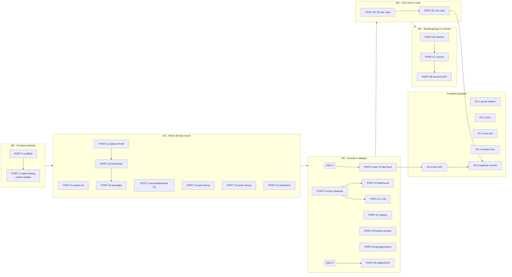

# Roadmap pelaksanaan

Urutan kerja untuk pelaksana. Planner (owner + agent) menyusun rencana, spec, dan scaffold;
**pelaksana mengambil task dari sini, satu task satu PR**. Status selalu dibaca dari
[BACKLOG.md](BACKLOG.md); dokumen ini hanya urutan dan alasannya.

Dua jalur berjalan paralel: **Port** (backend ke Rust) dan **Frontend** (UI mengikuti guidelines).
Jalur Operasi punya satu item yang tidak boleh terlewat: `OPS-1` sebelum 2026-12-13.

## M0 · Fondasi — selesai

Gate, ratchet, CI, dokumen produk, scaffold Rust tujuh crate, dan **`PORT-1` sebagai contoh
lengkap** alur porting: oracle → case file → port → test paritas. Pelaksana sebaiknya membaca
contoh itu dulu: `scripts/oracle/modules.ts`, `scripts/oracle/cases.ts`,
`tests/parity/makro-hitung.cases`, `rust/crates/pemdi-domain/src/makro.rs`,
`rust/crates/pemdi-domain/tests/parity_makro.rs`.

## M1 · Alat dan domain murni

Mulai di sini. Tidak butuh lakehouse, LLM, atau keputusan owner.

| Urutan | Task | Kenapa urutan ini |
| --- | --- | --- |
| 1 | `PORT-2` | Reviewer butuh kasus yang belum dilihat sebelum menerima port berikutnya |
| 2 | `TEST-1` | Menjaga UI lama tetap benar selama porting |
| 3 | `PORT-11` | Daun terpenting: angka Indeks Pemdi; `PORT-12`, `PORT-13`, dan use case dasbor bergantung padanya |
| 4 | `PORT-12` → `PORT-13` | Mengikuti dependensi |
| 5 | `PORT-14`, `PORT-15`, `PORT-10` | Bebas urutan; `PORT-10` butuh tipe `NilaiMakro` di contracts |

Selesai bila semua baris ledger §1 berstatus "parity green".

## M2 · Kontrak dan adapter

`PORT-4` menunggu `DEC-2`; `PORT-24` menunggu `DEC-5`. Adapter lain bisa jalan setelah `PORT-3`
(oracle berupa rekaman permintaan/respons). Selesai bila ledger §2 "parity green" dan `pemdi-api`
`/api/health` melapor `ok` terhadap lakehouse sungguhan.

## M3 · Use case dan route

Ledger §3 lalu §4, mengikuti "Blocked by" di backlog. Setiap route baru mengembalikan bentuk
respons **yang sama persis** dengan route TS lama (respons dibekukan, ADR 0001).

## M4 · Berdampingan dan cutover

`PORT-46`: kontainer `pemdi-api` di stack, Next.js meneruskan route yang sudah diporting dan
mencatat selisih. `PORT-47`: cutover per kelompok route setelah 7 hari tanpa selisih, lalu kode TS
dihapus di minggu yang sama. `PORT-48`: konvensi API RantAI.

## Frontend (paralel sejak M1)

`FE-1`–`FE-4` tidak bergantung pada Rust dan bisa dikerjakan kapan saja. `FE-6` dan `FE-5`
menunggu `PORT-4` dan route Rust masing-masing. Rinciannya di
[`../port/frontend-audit.md`](../port/frontend-audit.md).

## Yang menunggu owner

`DEC-2` (pembangkit tipe), `DEC-3` (LLM produksi), `DEC-4` (alat build data), `DEC-5` (OCR),
`DEC-6` (PROSN). Pelaksana tidak memutuskan ini; bila task tertahan, tulis di PR dan lanjut ke
task lain.
